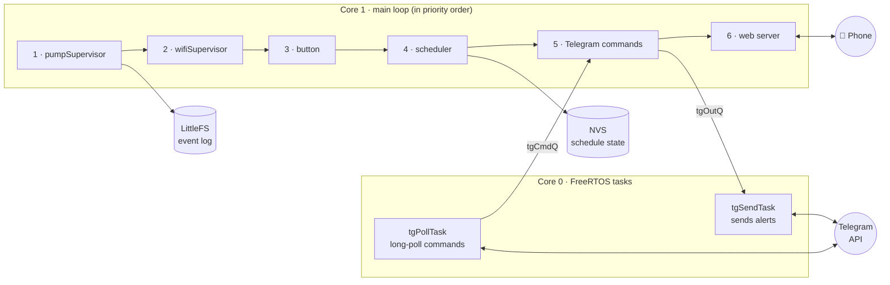

# 💧 ESP32-S3 Balcony Irrigation Controller

[](https://github.com/OferShulami/esp32-irrigation-controller/actions/workflows/build.yml)


[](LICENSE)

A standalone irrigation controller for a balcony garden, built on an **ESP32-S3**.
It waters on a daily schedule, can be controlled from a phone web page or from **Telegram, from anywhere**,
and is designed around one rule: **the pump must never run when it shouldn't.**

> The user interface (web page, Telegram messages, serial output) is in Hebrew.

---

## ✨ Features

| | |
|---|---|
| 📅 **Daily schedule** | Waters every day at a set time (default 07:30, 5 min). Missed runs are detected and reported. |
| 🌍 **Remote control via Telegram** | `/on`, `/off`, `/skip`, `/status` from anywhere. Only the owner's chat is accepted. |
| 📱 **Phone web page** | Live status, manual run, skip-next, full event history. Add to home screen like an app. |
| 🔔 **Alerts** | Telegram push on boot, missed/partial watering, safety shut-offs, network loss and recovery. |
| 📜 **Persistent event log** | 500-event ring buffer on LittleFS. Survives power loss; events logged before time sync get their timestamps back-filled. |
| 🕒 **Two time sources** | NTP, plus the phone's clock as a fallback when NTP is slow. Israel time zone incl. DST. |
| 🔁 **Multi-network WiFi** | Rotates through several networks forever until one answers. |

## 🛡️ Safety design

Watering hardware fails in expensive ways (flooding, a dry-running pump). The firmware is built defensively:

- **Relay forced OFF first** in `setup()`, before anything else runs, and **re-asserted on every loop**.
- **Hard 10-minute cap** on any run, enforced independently of the requested duration.
- **Fail-safe when offline:** after ~45 s without a network the pump is stopped and locked. Nobody can start it (not even the button) until the connection is back. **Stopping always works.**
- **Honest reporting:** a scheduled run is reported as done only when it *finishes*. If it was interrupted, even by a power cut, the next boot reports it as partial.
- **Telegram never touches the pump directly.** Bot tasks run on core 0 and only pass commands through a queue; all pump decisions happen in the main loop.
- Commands are accepted **only from the owner's chat ID**.

## 🏗️ Architecture



## 🔌 Hardware

| Part | Notes |
|---|---|
| ESP32-S3 DevKit (44-pin, no PSRAM) | |
| 12 V pump + 12 V / 6 A supply | Buck converter to 5 V for the board |
| Relay module, active LOW | `GPIO4` |
| Emergency button | `GPIO0` (BOOT) for now, `GPIO5` planned |
| Water-level sensor (planned) | `GPIO1` (ADC1, works alongside WiFi) |

Full wiring notes and safety checklist: **[docs/hardware.md](docs/hardware.md)**.

## 🚀 Getting started

**1. Credentials.** Copy the template and fill in your WiFi and Telegram values:

```bash
cp firmware/Irrigation/secrets.example.h firmware/Irrigation/secrets.h
```

`secrets.h` is git-ignored, so passwords never reach GitHub.

**2. Settings** such as schedule time, pins and safety limits live in [`config.h`](firmware/Irrigation/config.h).

**3. Build and flash**, either with **Arduino IDE** (open `firmware/Irrigation/Irrigation.ino`), using:

| Tools menu | Value |
|---|---|
| Board | ESP32S3 Dev Module |
| USB CDC On Boot | Enabled |
| PSRAM | Disabled |
| Partition Scheme | Default 4MB with spiffs |

or with **arduino-cli**:

```bash
arduino-cli compile --upload -p /dev/cu.usbmodem1101 -b "esp32:esp32:esp32s3:CDCOnBoot=cdc,PSRAM=disabled,PartitionScheme=default" firmware/Irrigation
```

**4. Telegram bot:** create one with [@BotFather](https://t.me/BotFather), get your chat ID from [@userinfobot](https://t.me/userinfobot), and put both in `secrets.h`.

## 🤖 Telegram commands

| Command | Action |
|---|---|
| `/status` | Pump state, network, today's schedule result, last 5 events |
| `/on 5` | Run the pump for 5 minutes (max 10) |
| `/off` | Stop the pump |
| `/skip` | Skip the next scheduled watering |
| `/unskip` | Cancel the skip |

Remote control can be turned off with `TG_REMOTE_CONTROL 0` in `config.h` (alerts and `/status` keep working).

## 🌐 HTTP API

| Method | Path | Parameters |
|---|---|---|
| `GET` | `/` | Phone web page |
| `GET` | `/api/status` | JSON status |
| `POST` | `/api/pump` | `action=on\|off`, `sec` |
| `POST` | `/api/skip` | `on=0\|1` |
| `POST` | `/api/time` | `epoch` (phone clock fallback) |
| `GET` | `/api/events` | `offset`, `limit` (≤ 100) |
| `POST` | `/api/clear` | Clear the event log |

Serial monitor (115200): `s` status · `l` last 20 events · `x` test run in 2 minutes · `r` restart.

## 📁 Project structure

```
firmware/Irrigation/
├── Irrigation.ino        # main logic: pump, schedule, WiFi, web API, event log
├── config.h              # all tunable settings
├── secrets.example.h     # template → copy to secrets.h (git-ignored)
├── telegram.h            # bot: sender + long-poll receiver tasks
└── webpage.h             # phone UI (HTML/JS, served from flash)
docs/hardware.md          # wiring and safety checklist
```

## 🗺️ Roadmap

- [x] WiFi with multiple networks, NTP + phone time
- [x] Phone web page and persistent event log
- [x] Daily schedule with skip, missed-run and partial-run detection
- [x] Telegram alerts and remote control
- [ ] Hardware watchdog (`esp_task_wdt`)
- [ ] External emergency button on GPIO5
- [ ] Relay bring-up without load
- [ ] Water-level sensor with dry-run protection
- [ ] Pump power stage (flyback diode, capacitor) and balcony install
- [ ] OTA firmware updates

## 📄 License

[MIT](LICENSE)
